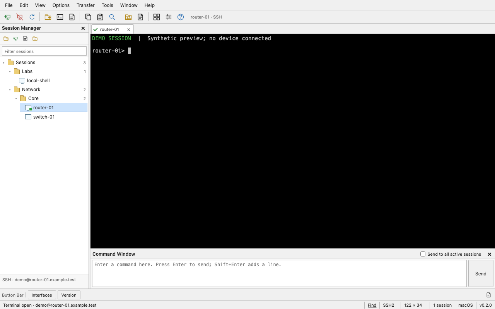

# Harbor Terminal

A free, open-source desktop terminal client for macOS, Windows, and Linux. Harbor Terminal brings saved connections, SSH terminals, tabs, tiled views, and reusable commands into one application.



The preview uses synthetic sessions and output; no device is connected.

## Download

[Download the v0.2.0 public preview](https://github.com/distractedagain/harbor-terminal/releases/tag/v0.2.0). Release notes identify the available platforms and verification limits. The packages are unsigned; macOS and Windows may show an operating-system warning when opening them.

The source is available under the MIT license. There is no subscription, activation, account, or cloud service requirement.

This is an original implementation of familiar terminal-client workflows, informed by [SecureCRT's public product description](https://www.vandyke.com/products/securecrt/) and [public feature overview](https://www.vandyke.com/products/securecrt/key_features.html). No VanDyke source code, executable disassembly, artwork, or proprietary scripting API is included. Harbor Terminal is independent of VanDyke Software; SecureCRT is its trademark.

## Included

- SSH and interactive SFTP through the operating system's OpenSSH client, plus local shell terminals.
- Saved sessions organized into folders, session search, tabs, and tiled terminals.
- SSH identity files, jump hosts, and local, remote, and dynamic port forwarding.
- Command snippets with a preview and confirmation before sending to multiple terminals.
- Opt-in output logging, terminal search, themes, and font preferences.
- JSON configuration import/export and a limited importer for plain SecureCRT SSH2 session INI files. Passwords and proprietary settings are excluded.

See [the feature map and limits](docs/FEATURES.md). This is an initial application, not complete SecureCRT feature parity. Windows and Linux native runtime verification is still required; CI definitions are included to build and test on all three platforms.

## Classic desktop layout

Version 0.2 uses a compact desktop layout modeled on SecureCRT's familiar window organization: menus and an icon toolbar, a nested Session Manager at the left, flat terminal tabs, a Command Window, a Button Bar, and a segmented status bar. New workspaces default to light gray controls and a black terminal; existing theme preferences remain available.

Click a saved session to select it, then double-click it, press Enter, or choose Connect. Use View to show or hide the Session Manager, Command Window, and Button Bar. Drag the panel dividers to resize the session tree and Command Window. Button Bar commands populate the Command Window for review before sending.

## Run from source

Install Node.js 24 and npm (the source requires Node.js 22 or newer). Native module compilation requires a C++ compiler and Python: Xcode Command Line Tools on macOS, Visual Studio Build Tools with the C++ workload on Windows, or your distribution's C++ build tools on Linux.

The `ssh` and `sftp` programs must be available on your PATH for remote sessions. On Windows, enable the OpenSSH Client optional feature if these commands are missing. Local terminals can run without them.

From this directory:

```sh
npm ci
npm start
```

To obtain the source first:

```sh
git clone https://github.com/distractedagain/harbor-terminal.git
cd harbor-terminal
```

Use `npm install` if you are changing dependencies. The lockfile makes clean installs repeatable. Installation fetches dependencies and Electron and builds the native terminal module.

Choose **Local shell** to open a terminal. Save an SSH connection with its host, username, and port, then connect. OpenSSH's authenticity and authentication prompts appear inside the terminal. Verify a new server's fingerprint through a trusted source before accepting it.

## Test and package

```sh
npm test
npm run build
npm run dist
```

`npm run smoke` opens the desktop app and exercises a real local PTY and a temporary loopback SSH server, including new-host confirmation, password authentication, remote output, and changed-key refusal. It requires a graphical desktop and OpenSSH's `ssh`/`ssh-keygen` commands. The test uses an isolated application profile and known-hosts file and writes its result and screenshot to a temporary directory. It still uses your ordinary local shell environment.

Version 0.1 was verified on macOS x64 on October 12, 2026: all 16 backend tests passed, and the desktop checks passed for renderer isolation, saved-profile round trips, real local PTYs, two tiled terminals, broadcast withheld until confirmation and then delivered to two targets, persisted preferences, and terminal search. Profile form switching, multiline snippets and commands, and canceled multiline paste were also checked. The system SSH client passed an isolated loopback test for a new-host prompt, password authentication, remote output, and refusal after the server host key changed. The packaged application launched and returned real local-shell output. The 0.2 interface redesign is checked separately without launching Electron; those browser checks use a synthetic bridge and do not establish new live SSH or PTY results. Native Windows/Linux execution, real SFTP transfers, and key/jump-host/forwarding integration have not yet been exercised.

Version 0.2 passed the 16 backend tests and 20 headless interface checks, with no browser console errors. Its menu, toolbar, tree, tabs, panel dividers, command review, and responsive layout were checked at 1280 × 800 and 850 × 600. See [the interface verification report](docs/UI-VERIFICATION.md).

Packaging runs on the current operating system and writes to `release/`. The configured targets are macOS ZIP/DMG, Windows NSIS/portable EXE, and Linux AppImage/DEB. Build each platform on a matching machine or use the provided GitHub Actions workflows. Apple code signing/notarization and Windows code signing require your own certificates and release setup; unsigned local builds may trigger operating-system warnings.

The workflows retain build artifacts. They do not publish a GitHub release or upload application configuration. A successful CI run is evidence of that runner's tests and packaging, not a substitute for an interactive remote-session test.

## Connections and privacy

Harbor Terminal launches system OpenSSH without a shell wrapper, with connection arguments passed separately. It uses OpenSSH's known-hosts and authentication mechanisms. Passwords and private-key contents are not stored in Harbor's saved sessions. The existing SSH agent can supply authentication keys. Harbor ignores SSH configuration files and uses the settings you enter in the session editor, so SSH aliases and configured proxy commands are not imported automatically.

Saved sessions and exported configuration can contain hostnames, usernames, paths, forwarding rules, and command snippets. Output logs can contain secrets printed by a local or remote program. Review these files before sharing them. See [SECURITY.md](SECURITY.md) for the security boundary and reporting guidance.

## Contributing and license

[Contributions](CONTRIBUTING.md) are welcome. Harbor's original source is licensed under [MIT](LICENSE), with no subscription or activation requirement. Dependencies retain their respective licenses; MIT does not relicense Electron, xterm.js, node-pty, OpenSSH, or other third-party code.
