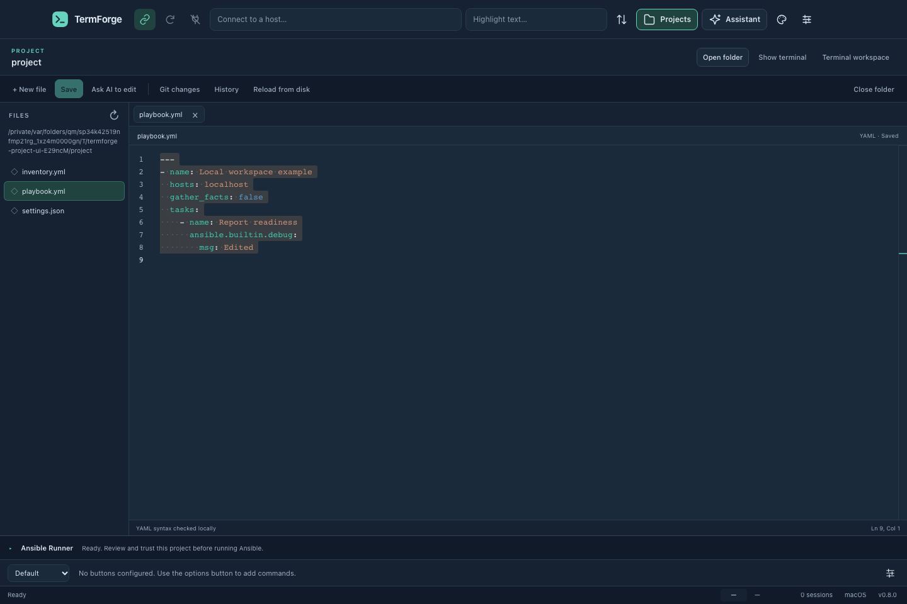
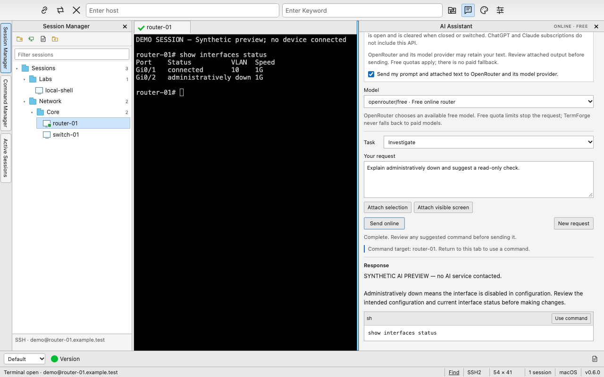
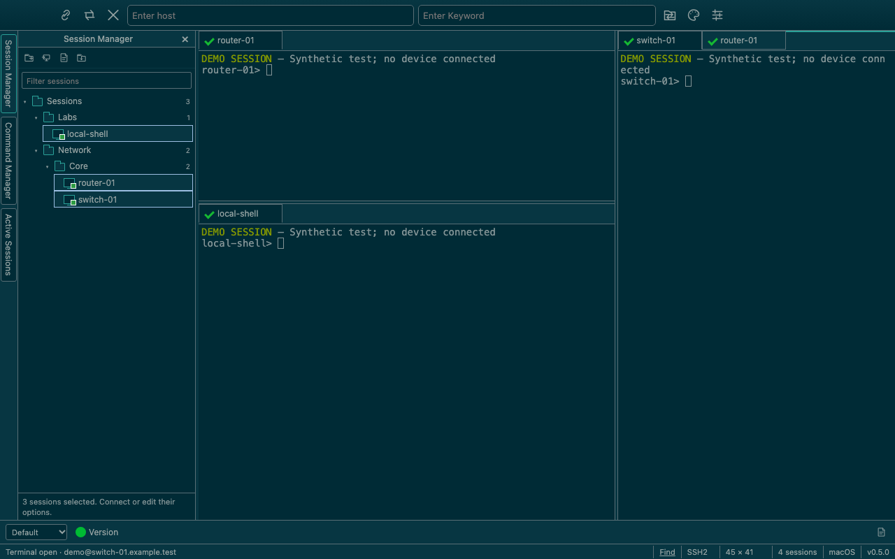
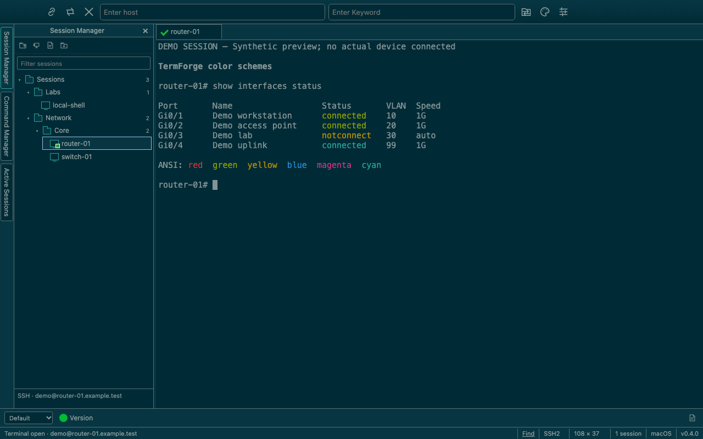

# TermForge

A free, open-source desktop terminal and automation client for macOS, Windows, and Linux. TermForge combines saved sessions, terminal connections, reusable commands, Python automation, and a local project editor with reviewed Ansible runs. The project is being developed toward SecureCRT 9.7 feature parity across all three platforms, with an original modern interface.



This 0.8 preview uses a temporary localhost project; no device is connected. It was captured in a headless browser, so native window controls are not shown.

## Download

[Download the TermForge v0.8.0 public preview](https://github.com/distractedagain/termforge/releases/tag/v0.8.0) for macOS Apple Silicon/Intel, Windows x64, or Linux x64. The release includes checksums and a build record for each platform. macOS packages use ad-hoc signatures and are not notarized; Windows packages are unsigned. See the release notes for requirements and verification limits.

Earlier previews remain available: [TermForge v0.7.0](https://github.com/distractedagain/termforge/releases/tag/v0.7.0), [v0.6.1](https://github.com/distractedagain/termforge/releases/tag/v0.6.1), [v0.5.0](https://github.com/distractedagain/termforge/releases/tag/v0.5.0), [v0.4.0](https://github.com/distractedagain/termforge/releases/tag/v0.4.0), [v0.3.0](https://github.com/distractedagain/termforge/releases/tag/v0.3.0) and [Harbor Terminal v0.2.0](https://github.com/distractedagain/termforge/releases/tag/v0.2.0). Version 0.6.1 introduced the AI Assistant; v0.5 and earlier predate it. Version 0.4 and earlier also lack the 0.5 tab groups and detailed snapshots. Version 0.2 retains the Harbor name. Existing Harbor configuration folders and the `HARBOR_DATA_DIR` override are still recognized.

The source is available under the MIT license. Core terminal features require no subscription, activation, account, or cloud service. Optional free online AI requires your own OpenRouter account and API key; local AI uses a separately installed Ollama model.

### Opening the macOS preview

If macOS says it cannot verify the developer or check TermForge for malware, the preview's missing Apple notarization can cause this warning. For a copy downloaded from the release above that you choose to trust:

1. Try opening **TermForge** once, then dismiss the warning.
2. Open **System Settings → Privacy & Security** and scroll down to **Security**.
3. Find the message naming **TermForge**, click **Open Anyway**, and then click **Open** in the confirmation.

This creates an exception for this app. Follow [Apple's opening instructions](https://support.apple.com/en-us/102445); these steps concern an unidentified developer or missing notarization, not a warning that an app will damage your computer.

This is an original implementation informed by [SecureCRT's public product description](https://www.vandyke.com/products/securecrt/) and public documentation. No VanDyke source code, executable disassembly, or copied artwork is included. The Python bridge independently implements a limited set of familiar public method names; full SecureCRT script compatibility is not established. TermForge is independent of VanDyke Software; SecureCRT is its trademark.

## New in 0.8 — Project workspace

Edit automation files alongside your terminal sessions with the locally bundled Monaco editor. File tabs, YAML diagnostics and Ansible snippets, JSON language services, and Python/Jinja editing support a complete edit/review/save workflow. Git status and diffs are read-only. Saves detect external changes and retain up to twenty private backup versions per file outside the project.

Ansible runs require an explicitly trusted project, saved playbook and inventory, and review of the selected mode and targets. Use Syntax, Check + diff or Run, then follow task/host results and cancel an active controller when needed. Ansible Core and Runner must be installed separately: macOS/Linux use a local Python environment; Windows uses WSL. AI file proposals open a diff, apply to the editor, and require a separate save; they never start commands or playbooks automatically. See [Project workspace](docs/PROJECT-WORKSPACE.md).

The local 0.8 source passed **200/200 backend tests** with no skips, **97/97 existing interface checks**, **13/13 project interface checks**, and **7/7 real localhost Ansible checks**. The interface runs recorded no browser errors. The localhost checks used Python 3.14.8, Ansible Core 2.21.5 and Runner 2.4.3.

At source `c2d00e3c9284a6c304f821cf2698a50f46dce847`, all four [CI jobs](https://github.com/distractedagain/termforge/actions/runs/38342881401) and all four [packaging jobs](https://github.com/distractedagain/termforge/actions/runs/38342904453) passed; packaging succeeded on its first attempt. Both Macs and Linux passed 200 backend tests each plus 7 real localhost Ansible checks; Windows passed 195 backend tests with five expected platform-specific skips. Both Mac packages passed strict recursive ad-hoc signature checks. Linux also passed the 97 interface and 13 project checks plus a real Electron source-app smoke: native clipboard completion, YAML/JSON file saves, a working custom-protocol JSON worker, no CSP violations and no terminal writes from editor actions. Folder selection was stubbed. See [verification details](docs/UI-VERIFICATION.md).

No Electron window was launched on the development laptop. Packaged interactive behavior, real WSL, device collections and live AI inference remain unverified.

The [v0.8.0 publisher](https://github.com/distractedagain/termforge/actions/runs/38343844109) verified all eight packages, four build records and the checksum manifest before publication. All thirteen public assets match GitHub's SHA-256 digests, and all twelve manifest entries match their assets. Anonymous downloads of the manifest and four build records confirmed the tagged source; the installers were not downloaded again during that public verification.

## Modern workspace added in 0.7

The 0.7 preview introduces TermForge's own slate and teal interface: a horizontal Sessions/Commands/Active switcher, consistent vector icons and app mark, a welcome screen, clearer dialogs and a refined AI Assistant. Light/dark modes and optional Solarized interface matching remain available. Session management, tab groups, commands and explicit AI review retain their existing workflows. See [the modern interface guide](docs/MODERN-INTERFACE.md).

The 0.7.0 source passed **156 backend tests and 97 headless interface checks**, with no failures or browser errors. Coverage includes compact layouts, keyboard focus, reduced motion, palette inheritance and layout persistence across restart. Packaged interactive behavior remains unverified.

Version 0.7.0 [native CI](https://github.com/distractedagain/termforge/actions/runs/38335309021), [packaging](https://github.com/distractedagain/termforge/actions/runs/38335319969), and [publication](https://github.com/distractedagain/termforge/actions/runs/38335846155) succeeded at tagged source `b2515479c65288e173fe6033b468d8233bbee258`. Both Mac architectures and Linux passed 156 backend tests each; Windows passed 153 with three expected POSIX-only skips. Linux passed 97 headless interface checks. All four package jobs passed on their first attempt. The twelve package/build-record files matched the checksum manifest; all thirteen public assets, including the manifest, matched GitHub's asset digests. Anonymous build-record downloads confirmed the tagged source. These results establish test and package provenance; live AI inference and packaged interactive behavior remain unverified.

## AI Assistant added in 0.6.1

Open **View → AI Assistant** to investigate output, explain errors or draft commands. Choose **Ollama (local)** or **Free online models (OpenRouter)**. Online requests use only the free router with zero price caps and no paid fallback; provider quotas and availability apply. Free ChatGPT and Claude chat accounts are not bundled API access.

Terminal text is attached explicitly with an editable preview. Online sending requires a masked, temporary API key and a sharing opt-in. Completed command suggestions enter the Command Window for review and confirmation against their original terminal. No commands run automatically. See [AI Assistant setup, privacy and limits](docs/AI-ASSISTANT.md).

The 0.6.1 source checks passed **156 backend tests and 91 headless interface checks**, with no failures or browser console errors. Model responses were simulated; live provider inference and packaged interactive behavior remain unverified.

Version 0.6.1 [native CI](https://github.com/distractedagain/termforge/actions/runs/38333067573), [packaging](https://github.com/distractedagain/termforge/actions/runs/38333067639), and [publication](https://github.com/distractedagain/termforge/actions/runs/38333586764) succeeded at tagged source `db72436817c6b11981371757136771e01414bdef`. Both Mac architectures and Linux passed 156 backend tests each; Windows passed 153 with three expected POSIX-only skips. Linux passed 91 headless interface checks. All four package jobs passed on their first attempt. The twelve package/build-record files matched the checksum manifest; all thirteen public assets, including the manifest, matched GitHub's asset digests. Anonymous build-record downloads confirmed the tagged source. These results establish test and package provenance, not live AI answer quality or packaged interactive behavior.

Version 0.6.0 remains a source tag only. Its Intel Mac packaging encountered a TFTP test-client failure when legitimate retransmissions arrived before the expected reply, so no 0.6.0 installer release was published. Version 0.6.1 corrects that fixture while retaining strict packet checks; the TFTP implementation is unchanged.



This 0.6 image uses a synthetic terminal and simulated AI response in a headless browser. No real model or device was contacted.

## Tab groups and workspace snapshots added in 0.5

The 0.5 preview adds independent tab groups with adjustable splits, tab movement, and per-group selected terminals. Use **Window → New Vertical Tab Group**, **New Horizontal Tab Group**, or **Collapse Tab Groups**. Existing tile commands remain available.

Snapshots now preserve repeated saved-session connections, tab order, each group's selected tab, focused group and split sizes. Restore adds the saved arrangement beside current tabs and reports partial failures. Older snapshots remain readable; unsaved quick connections must be saved as profiles first. See [Tab Groups and Snapshots](docs/TAB-GROUPS.md).

The 0.5 source passed **115 backend tests and 72 headless interface checks**, with no failures or browser console errors. Tests cover live tab movement, keyboard/pointer resizing, duplicate-session restoration, partial failures, and reconnecting with close-on-exit enabled. Packaged interactive runtime testing remains pending.

Version 0.5 [native CI](https://github.com/distractedagain/termforge/actions/runs/38328313996), [packaging](https://github.com/distractedagain/termforge/actions/runs/38328332260), and [publication](https://github.com/distractedagain/termforge/actions/runs/38328921919) passed on the first attempt at tagged source `a3697bcbb7c803edfde80d23e5c5769c621671ba`. Both Macs and Linux passed 115 backend tests each; Windows passed 112 with three POSIX-only skips. Linux passed 72 headless checks. All thirteen public release assets were verified against the checksum manifest and public asset digests, and the anonymously downloaded build records matched the tagged source.



This 0.5 preview uses synthetic sessions and output in a headless browser. No device is connected and native macOS window controls are not shown.

## Color schemes added in 0.4

The current source adds **Options → Color Schemes…** and a palette toolbar button. Choose Traditional, Monochrome, Solarized Dark, Solarized Light, Forge Dark, Forge Light, or High Contrast. Each preset defines all sixteen ANSI colors, foreground/background, cursor, and selection colors. The dialog renders a local ANSI sample; **Cancel** or **Escape** leaves your saved settings and live terminals unchanged.

Choose **Match interface to default scheme** to also color TermForge's toolbars, managers, tabs, and dialogs while preserving the compact desktop layout. **Apply** updates open terminals that inherit the global scheme. Per-session overrides remain independent; Session Options includes the same palettes and a **Use Global Options** choice. See [Color Schemes](docs/COLOR-SCHEMES.md) for details and [Ethan Schoonover's Solarized project](https://ethanschoonover.com/solarized/) for the original palette.

The 0.4 preview is published. Its local source passed **92 backend tests and 63 headless interface checks**, with no failures or browser console errors. Coverage includes palette validation, inheritance and persistence, preview cancellation, failed-save handling, and live renderer updates. Native build and release evidence is recorded below.



This 0.4 image uses synthetic sessions and output in a headless browser; it does not show a connected device or native macOS window controls. See [the color guide](docs/COLOR-SCHEMES.md) for the light variant and palette picker.

## Included

- Local project editor with file tabs, YAML/JSON assistance, Python/Jinja editing, reviewed Git status/diffs, conflict-checked saves and private backup history.
- Explicitly trusted Ansible syntax, check/diff and run workflows with target review, task/host results and cancellation; external Ansible Core/Runner required.
- AI whole-file proposals with a diff review and separate apply/save steps.
- Optional AI Assistant with local Ollama or the OpenRouter free router, explicit context sharing, streaming/cancellation and reviewed commands pinned to their original terminal.
- SSH, interactive SFTP, and local shells through installed system tools; native Telnet and Raw TCP connections; serial device selection and connection settings.
- Saved session folders, filtering, Quick Connect, Connect Bar, multi-selection and selected-field bulk editing.
- Reorderable/cloned tabs, independent resizable tab groups, horizontal/vertical/grid tiling, an Active Sessions list, and snapshots retaining repeated saved-session connections and group layouts.
- Categorized Session/Global Options, per-session font/color/cursor/scrollback, mapped text/menu keys, and literal keyword highlighting.
- A nested Command Manager, named Button Bars, command history, and reviewed multi-session sends.
- Installed Python execution with a documented send/wait/read/tab/screen API subset, cancellation, output display, and reviewed input recording.
- Opt-in output logs with pause/resume, terminal search, reviewed ASCII file sends, and a restricted octet TFTP server.
- SSH identity/certificate paths, jump host, requested forwarding, authentication/algorithm controls, compression and keepalive options.
- JSON configuration import/export, version-1 migration, and a limited importer for plain nonsecret SecureCRT SSH2 session INI fields.

See [the feature map](docs/FEATURES.md) and [the sourced parity ledger](docs/SECURECRT-PARITY.md) for implemented subsets, missing features and acceptance gates. Distinct legacy emulations, SSH1/RLogin, credential/key managers, advanced proxies, modem transfer protocols, printing, complete automation compatibility, live tabs across multiple windows, and Windows-specific RDP/ActiveX features remain gaps. Full feature parity remains in development; the modern interface follows TermForge's own visual design.

## Historical interface — v0.3

Version 0.3 used SecureCRT 9.7 macOS as a visual reference: the native macOS menu, one compact toolbar with Connect/Keyword fields, vertical Session/Command/Active manager selectors, terminal tabs, Command Window, named Button Bar and segmented status bar. Windows and Linux exposed in-window menus. Light/dark controls and independent terminal schemes were available. The 0.7 preview replaces that visual direction with an original modern interface; earlier screenshots remain historical evidence.

The established interaction workflow continues in 0.7: click a saved session to select it, then double-click it, press Enter, or choose Connect. Use View to select managers and show/hide panels. Resize the manager and Command Window with their dividers. Button Bar commands populate the Command Window for review; Command Manager Enter/double-click sends through the command workflow.

## Run from source

Install Node.js 24 and npm (the source requires Node.js 22 or newer). Native module compilation requires a C++ compiler and Python: Xcode Command Line Tools on macOS, Visual Studio Build Tools with the C++ workload on Windows, or your distribution's C++ build tools on Linux.

The `ssh` and `sftp` programs must be available on PATH for those protocols. On Windows, enable OpenSSH Client if they are missing. Local/Telnet/Raw/serial sessions do not require those executables. Python automation requires an installed Python 3 interpreter (`python3` on macOS/Linux, `python` on Windows); Python is not bundled.

Project editing does not require Ansible. To execute playbooks, install Ansible Core and Runner in a compatible Python environment and select that interpreter in the project workspace. Windows requires a controller inside WSL. Git review requires an installed Git executable and the selected folder to be a repository root; linked worktrees, submodules and repository configuration that enables external execution are excluded. See [runtime setup and limits](docs/PROJECT-WORKSPACE.md).

Get the source and start the application:

```sh
git clone https://github.com/distractedagain/termforge.git
cd termforge
npm ci
npm start
```

Use `npm install` if you are changing dependencies. The lockfile makes clean installs repeatable. Installation fetches dependencies and Electron and prepares native PTY/serial modules. `npm start` opens a desktop window.

Choose **Local shell** to open a terminal. Save an SSH connection with its host, username, and port, then connect. OpenSSH's authenticity and authentication prompts appear inside the terminal. Verify a new server's fingerprint through a trusted source before accepting it.

## Test and package

```sh
npm test
npm run build
npm run test:ui
npm run dist
```

`npm run smoke` opens the desktop app and exercises a real local PTY and a temporary loopback SSH server, including new-host confirmation, password authentication, remote output, and changed-key refusal. It also checks the project editor through the actual Electron preload bridge: custom-protocol JSON worker messages/diagnostics, native clipboard copy/paste, a real fixture-file save, CSP behavior and absence of terminal writes from editor actions. Folder-selection results are stubbed; the smoke does not operate an interactive OS folder picker. It requires a graphical desktop and OpenSSH's `ssh`/`ssh-keygen` commands. The test uses an isolated application profile and known-hosts file and writes results/screenshots to a temporary directory. It still uses your ordinary local shell environment.

The expanded Electron smoke passed on Linux CI at the source above, including both desktop and editor PNG captures. It exercised the source app through Electron rather than an installed release package. Clipboard IPC now acknowledges a write only after the native clipboard operation finishes. No Electron window was launched on the development laptop. Current 0.8 results are recorded above and in [the interface report](docs/UI-VERIFICATION.md). The historical local 0.7.0 suite passed **156 backend tests and 97 headless renderer checks**, with zero failures and no browser console errors. TCP/Telnet and TFTP tests use real loopback sockets; automation tests launch real Python interpreters with fixture terminal/screen callbacks. Serial tests use injected adapters and the installed SerialPortMock, not physical hardware. The established renderer checks use a synthetic bridge, actual validators and recorder generation; they do not open Electron or perform real connections, scripts or transfers. Install the headless browser first with `npx playwright install --with-deps chromium --only-shell` where needed.

`npm run test:projects` exercises the project interface with real temporary files/Git and synthetic AI/Ansible events. `TERMFORGE_TEST_PYTHON=/absolute/path/to/venv/bin/python npm run test:ansible` exercises real Ansible against a temporary localhost fixture, including a temporary file write; it requires a separately installed compatible runtime. Neither harness launches Electron or contacts a network device.

For v0.4, [native CI](https://github.com/distractedagain/termforge/actions/runs/38324020057) and [packaging](https://github.com/distractedagain/termforge/actions/runs/38324019614) passed at tagged source `0e9ae540293fac90d0c31649705fed6fdb2f2df3`. Both Mac architectures and Linux passed 92 backend tests each; Windows passed 89 with three POSIX-specific skips. Linux passed 63 headless interface checks. Both Mac packages passed strict recursive ad-hoc signature verification. The Windows package job required one retry after interpreter-start and UDP-fixture timeouts; it passed at the same commit without changing code or assertions. The [publisher](https://github.com/distractedagain/termforge/actions/runs/38325248387) validated all thirteen release assets. Anonymous downloads of the checksum manifest and four build records matched the public GitHub asset digests and tagged source.

Historically, v0.3 [native CI](https://github.com/distractedagain/termforge/actions/runs/38320236458) and [packaging](https://github.com/distractedagain/termforge/actions/runs/38320240854) passed for all four targets at released source commit `09abaaefbb440d0600647ac389e32f72dca98700`. Both Mac architectures and Linux passed 84 backend tests each; Windows passed 81 with three POSIX-specific tests skipped. Linux also passed 46 headless interface checks. Both Mac packages passed strict recursive ad-hoc signature verification. The [v0.3 publisher](https://github.com/distractedagain/termforge/actions/runs/38320923229) verified all packages, source records and checksums before making that preview public.

A user reported that the installed v0.3 macOS app opened successfully and that its local shell and an SSH connection worked. This is limited manual feedback, not a complete packaged-app runtime test matrix. Real SFTP, key/agent/jump/forwarding, physical serial and LAN-device interoperability need further integration tests. Historical Harbor 0.1 macOS Intel testing established real local PTYs and isolated SSH new-host/password/changed-key behavior. Harbor 0.2 passed 20 synthetic interface checks and native source/build/package CI. See [the historical v0.2 interface report](docs/UI-VERIFICATION.md). Those historical results do not certify the current packaged native runtime.

Packaging runs on the current operating system and writes to `release/`. The configured targets are macOS ZIP/DMG, Windows NSIS/portable EXE, and Linux AppImage/DEB. Build each platform on a matching machine or use the provided GitHub Actions workflows. macOS packaging applies an ad-hoc signature for compatibility, without a paid certificate or notarization. Trusted Apple Developer ID signing/notarization and Windows publisher signing require your own certificates and release setup.

The test and build workflows retain build artifacts. A separate, manually dispatched publisher verifies all four platform artifacts, their checksums and source commit, and the complete upload before publishing a preview release. These workflows do not upload application configuration. A successful CI run is evidence of that runner's tests and packaging, not a substitute for an interactive remote-session test.

## Connections and privacy

TermForge launches system OpenSSH without a shell wrapper, passing arguments separately and preserving host-key checks. Saved sessions do not store password/private-key contents; the system agent may supply keys. SSH configuration aliases/proxy commands are ignored. Telnet, Raw TCP and TFTP do not encrypt network traffic. Python scripts run with your local user permissions, and enabled input recording can capture sensitive input. Review recordings before saving or replaying them.

Configuration exports/history/snippets may reveal infrastructure or commands; output logs may contain secrets. The TFTP server starts only explicitly, defaults to loopback port 6969, permits one chosen client IP and shares one selected folder; uploads create new files without replacing existing files. See [Python automation](docs/PYTHON-AUTOMATION.md), [TFTP limits](docs/TFTP.md), and [SECURITY.md](SECURITY.md).

Opening a project does not execute its code. Ansible actions require trust because inventory plugins, roles, lookups and project configuration can execute code even during syntax or check mode. Cancellation does not undo completed changes or guarantee that remote operations stopped. Private file history may contain secrets from earlier revisions; it is stored outside the repository, with restricted permissions where supported. AI attachment and online-sharing controls also apply to file proposals.

## Contributing and license

[Contributions](CONTRIBUTING.md) are welcome. TermForge's original source is licensed under [MIT](LICENSE), with no subscription or activation requirement. Dependencies retain their respective licenses; MIT does not relicense Electron, xterm.js, node-pty, OpenSSH, or other third-party code.
