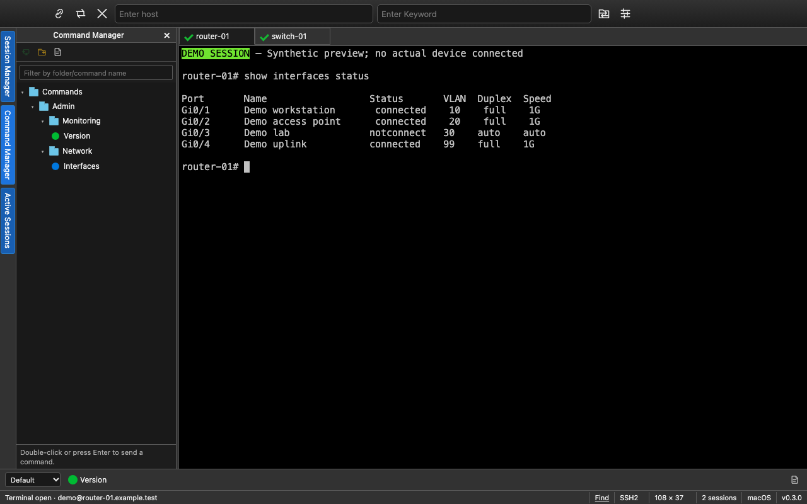

# TermForge

A free, open-source desktop terminal client for macOS, Windows, and Linux. TermForge combines saved sessions, terminal connections, reusable commands, and Python automation. The project is being developed toward SecureCRT 9.7 feature parity across all three platforms, using its macOS interface as the visual reference.



This 0.3 image uses synthetic sessions and output; no device is connected. It was captured in a headless browser, so native macOS window controls are not shown.

## Download

[Download the TermForge v0.3.0 public preview](https://github.com/distractedagain/termforge/releases/tag/v0.3.0) for macOS Apple Silicon/Intel, Windows x64, or Linux x64. The release includes checksums and a build record for each platform. macOS packages use ad-hoc signatures and are not notarized; Windows packages are unsigned. See the release notes for requirements and verification limits.

[Historical Harbor Terminal v0.2.0 downloads](https://github.com/distractedagain/termforge/releases/tag/v0.2.0) remain available and do not include the new 0.3 code or name. Existing Harbor configuration folders and the `HARBOR_DATA_DIR` override are still recognized.

The source is available under the MIT license. There is no subscription, activation, account, or cloud service requirement.

### Opening the macOS preview

If macOS says it cannot verify the developer or check TermForge for malware, the preview's missing Apple notarization can cause this warning. For a copy downloaded from the release above that you choose to trust:

1. Try opening **TermForge** once, then dismiss the warning.
2. Open **System Settings → Privacy & Security** and scroll down to **Security**.
3. Find the message naming **TermForge**, click **Open Anyway**, and then click **Open** in the confirmation.

This creates an exception for this app. Follow [Apple's opening instructions](https://support.apple.com/en-us/102445); these steps concern an unidentified developer or missing notarization, not a warning that an app will damage your computer.

This is an original implementation informed by [SecureCRT's public product description](https://www.vandyke.com/products/securecrt/) and public documentation. No VanDyke source code, executable disassembly, or copied artwork is included. The Python bridge independently implements a limited set of familiar public method names; full SecureCRT script compatibility is not established. TermForge is independent of VanDyke Software; SecureCRT is its trademark.

## In development — 0.4 color schemes

The current source adds **Options → Color Schemes…** and a palette toolbar button. Choose Traditional, Monochrome, Solarized Dark, Solarized Light, Forge Dark, Forge Light, or High Contrast. Each preset defines all sixteen ANSI colors, foreground/background, cursor, and selection colors. The dialog renders a local ANSI sample; **Cancel** or **Escape** leaves your saved settings and live terminals unchanged.

Choose **Match interface to default scheme** to also color TermForge's toolbars, managers, tabs, and dialogs while preserving the compact desktop layout. **Apply** updates open terminals that inherit the global scheme. Per-session overrides remain independent; Session Options includes the same palettes and a **Use Global Options** choice. See [Color Schemes](docs/COLOR-SCHEMES.md) for details and [Ethan Schoonover's Solarized project](https://ethanschoonover.com/solarized/) for the original palette.

The published download above remains v0.3.0 while the 0.4 release is being prepared. The 0.4 source passed **92 backend tests and 63 headless interface checks**, with no failures or browser console errors. Coverage includes palette validation, inheritance and persistence, preview cancellation, failed-save handling, and live renderer updates. Native build and release verification will be recorded separately.


This 0.4 image uses synthetic sessions and output in a headless browser; it does not show a connected device or native macOS window controls. See [the color guide](docs/COLOR-SCHEMES.md) for the light variant and palette picker.

## Included

- SSH, interactive SFTP, and local shells through installed system tools; native Telnet and Raw TCP connections; serial device selection and connection settings.
- Saved session folders, filtering, Quick Connect, Connect Bar, multi-selection and selected-field bulk editing.
- Reorderable/cloned tabs, horizontal/vertical/grid tiling, an Active Sessions list, and snapshots of saved session sets and basic layout.
- Categorized Session/Global Options, per-session font/color/cursor/scrollback, mapped text/menu keys, and literal keyword highlighting.
- A nested Command Manager, named Button Bars, command history, and reviewed multi-session sends.
- Installed Python execution with a documented send/wait/read/tab/screen API subset, cancellation, output display, and reviewed input recording.
- Opt-in output logs with pause/resume, terminal search, reviewed ASCII file sends, and a restricted octet TFTP server.
- SSH identity/certificate paths, jump host, requested forwarding, authentication/algorithm controls, compression and keepalive options.
- JSON configuration import/export, version-1 migration, and a limited importer for plain nonsecret SecureCRT SSH2 session INI fields.

See [the feature map](docs/FEATURES.md) and [the sourced parity ledger](docs/SECURECRT-PARITY.md) for implemented subsets, missing features and acceptance gates. Distinct legacy emulations, SSH1/RLogin, credential/key managers, advanced proxies, modem transfer protocols, printing, complete automation compatibility, independent tab groups/multiple windows, and Windows-specific RDP/ActiveX features remain gaps. TermForge is not yet near identical or feature complete.

## Classic desktop layout

Version 0.3 develops the SecureCRT 9.7 macOS layout: the native macOS menu, one compact toolbar with Connect/Keyword fields, vertical Session/Command/Active manager selectors, terminal tabs, Command Window, named Button Bar and segmented status bar. Windows and Linux expose in-window menus. Light/dark controls and independent terminal schemes are available. A comprehensive comparison with a running SecureCRT installation remains required.

Click a saved session to select it, then double-click it, press Enter, or choose Connect. Use View to select managers and show/hide panels. Resize the manager and Command Window with their dividers. Button Bar commands populate the Command Window for review; Command Manager Enter/double-click sends through the command workflow.

## Run from source

Install Node.js 24 and npm (the source requires Node.js 22 or newer). Native module compilation requires a C++ compiler and Python: Xcode Command Line Tools on macOS, Visual Studio Build Tools with the C++ workload on Windows, or your distribution's C++ build tools on Linux.

The `ssh` and `sftp` programs must be available on PATH for those protocols. On Windows, enable OpenSSH Client if they are missing. Local/Telnet/Raw/serial sessions do not require those executables. Python automation requires an installed Python 3 interpreter (`python3` on macOS/Linux, `python` on Windows); Python is not bundled.

Get the source and start the application:

```sh
git clone https://github.com/distractedagain/termforge.git
cd termforge
npm ci
npm start
```

Use `npm install` if you are changing dependencies. The lockfile makes clean installs repeatable. Installation fetches dependencies and Electron and prepares native PTY/serial modules. `npm start` opens a desktop window.

Choose **Local shell** to open a terminal. Save an SSH connection with its host, username, and port, then connect. OpenSSH's authenticity and authentication prompts appear inside the terminal. Verify a new server's fingerprint through a trusted source before accepting it.

## Test and package

```sh
npm test
npm run build
npm run test:ui
npm run dist
```

`npm run smoke` opens the desktop app and exercises a real local PTY and a temporary loopback SSH server, including new-host confirmation, password authentication, remote output, and changed-key refusal. It requires a graphical desktop and OpenSSH's `ssh`/`ssh-keygen` commands. The test uses an isolated application profile and known-hosts file and writes its result and screenshot to a temporary directory. It still uses your ordinary local shell environment.

The local 0.3 feature batch passed **84 backend tests** and **46 headless renderer checks**, with zero failures and no browser console errors. TCP/Telnet and TFTP tests use real loopback sockets; automation tests launch real Python interpreters with fixture terminal/screen callbacks. Serial tests use injected adapters and the installed SerialPortMock, not physical hardware. Renderer checks use a synthetic bridge, actual validators and recorder generation; they do not open Electron or perform real connections, scripts or transfers. Install the headless browser first with `npx playwright install --with-deps chromium --only-shell` where needed.

[Native CI](https://github.com/distractedagain/termforge/actions/runs/38320236458) and [packaging](https://github.com/distractedagain/termforge/actions/runs/38320240854) passed for all four targets at released source commit `09abaaefbb440d0600647ac389e32f72dca98700`. Both Mac architectures and Linux passed 84 backend tests each; Windows passed 81 with three POSIX-specific tests skipped. Linux also passed 46 headless interface checks. Both Mac packages passed strict recursive ad-hoc signature verification. The [publisher](https://github.com/distractedagain/termforge/actions/runs/38320923229) verified all packages, source records and checksums before making the preview public.

A user reported that the installed v0.3 macOS app opened successfully and that its local shell and an SSH connection worked. This is limited manual feedback, not a complete packaged-app runtime test matrix. Real SFTP, key/agent/jump/forwarding, physical serial and LAN-device interoperability need further integration tests. Historical Harbor 0.1 macOS Intel testing established real local PTYs and isolated SSH new-host/password/changed-key behavior. Harbor 0.2 passed 20 synthetic interface checks and native source/build/package CI. See [the historical v0.2 interface report](docs/UI-VERIFICATION.md). Those historical results do not certify the 0.4 native runtime.

Packaging runs on the current operating system and writes to `release/`. The configured targets are macOS ZIP/DMG, Windows NSIS/portable EXE, and Linux AppImage/DEB. Build each platform on a matching machine or use the provided GitHub Actions workflows. macOS packaging applies an ad-hoc signature for compatibility, without a paid certificate or notarization. Trusted Apple Developer ID signing/notarization and Windows publisher signing require your own certificates and release setup.

The test and build workflows retain build artifacts. A separate, manually dispatched publisher verifies all four platform artifacts, their checksums and source commit, and the complete upload before publishing a preview release. These workflows do not upload application configuration. A successful CI run is evidence of that runner's tests and packaging, not a substitute for an interactive remote-session test.

## Connections and privacy

TermForge launches system OpenSSH without a shell wrapper, passing arguments separately and preserving host-key checks. Saved sessions do not store password/private-key contents; the system agent may supply keys. SSH configuration aliases/proxy commands are ignored. Telnet, Raw TCP and TFTP do not encrypt network traffic. Python scripts run with your local user permissions, and enabled input recording can capture sensitive input. Review recordings before saving or replaying them.

Configuration exports/history/snippets may reveal infrastructure or commands; output logs may contain secrets. The TFTP server starts only explicitly, defaults to loopback port 6969, permits one chosen client IP and shares one selected folder; uploads create new files without replacing existing files. See [Python automation](docs/PYTHON-AUTOMATION.md), [TFTP limits](docs/TFTP.md), and [SECURITY.md](SECURITY.md).

## Contributing and license

[Contributions](CONTRIBUTING.md) are welcome. TermForge's original source is licensed under [MIT](LICENSE), with no subscription or activation requirement. Dependencies retain their respective licenses; MIT does not relicense Electron, xterm.js, node-pty, OpenSSH, or other third-party code.
