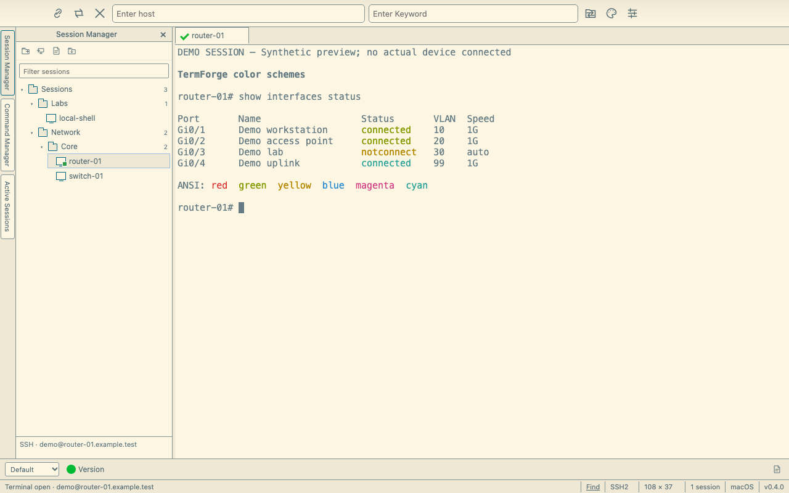
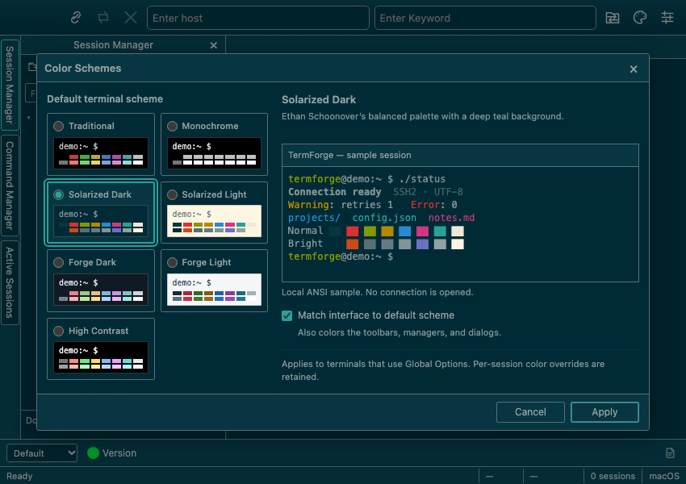

# Color schemes

The [0.4 preview](https://github.com/distractedagain/termforge/releases/tag/v0.4.0) adds a visual palette picker while keeping TermForge's compact desktop layout. Earlier v0.3 downloads predate this picker.

## Choose a default scheme

1. Choose **Options → Color Schemes…**, or click the palette button on the toolbar.
2. Select a scheme. The local terminal sample shows ordinary text, status messages, and all sixteen normal/bright ANSI colors.
3. Optionally enable **Match interface to default scheme**. The sample's title strip previews the matching interface colors.
4. Click **Apply** to save the choice and update open terminals that inherit the default.

Selection inside the dialog changes only the preview. **Cancel**, the close button, or **Escape** discards the draft. The preview never opens a connection or runs a command. While a save is in progress, the controls remain disabled; a failed save leaves the dialog open with an error so you can retry.

The same global scheme and matching-interface setting are available under **Options → Global Options… → Terminal**. Each palette defines terminal foreground and background, all sixteen ANSI slots, cursor and cursor accent, and active/inactive selection colors.

## Included presets

| Preset | Appearance |
| --- | --- |
| Traditional | Classic silver text on black with familiar ANSI colors |
| Monochrome | Grayscale terminal colors on black |
| Solarized Dark | Muted Solarized text and accents on deep teal |
| Solarized Light | The Solarized palette on a warm paper background |
| Forge Dark | Cool charcoal with copper and clear colored text |
| Forge Light | Cool paper with deep ink and muted colored text |
| High Contrast | Bright text and strong accents on black |

[Solarized](https://ethanschoonover.com/solarized/) was designed by Ethan Schoonover. TermForge uses the original sRGB values and ANSI slot assignments for its Solarized presets. Both variants share the same sixteen ANSI slots and change their foreground, background, cursor, and selection roles. Several “bright” slots intentionally contain muted base colors, as specified by Solarized.

These images show the 0.4 source in a headless browser with local synthetic sessions and ANSI text. They demonstrate renderer appearance; no remote device is connected, and native macOS window controls are not shown.

## Per-session colors

Select a saved session, choose **Options → Session Options… → Appearance**, and set **Color scheme**. **Use Global Options** follows the global default; an explicit scheme overrides it for that session. The inline ANSI sample shows the effective choice, including an inherited default.

Saving a session's appearance updates its open terminals without reconnecting or clearing their output. Changing the global default updates inheriting terminals and keeps explicit per-session choices. New connections use the saved choice. Connection-specific fields continue to apply on the next connection.

**Match interface to default scheme** is a global preference. It colors TermForge's toolbars, managers, tabs, dialogs, and status area using the global scheme; switching between sessions with different palettes does not change the interface colors. Turn matching off to restore the independently selected classic light or dark interface. Operating-system menus and other native controls remain under the system's control.

## Display and verification limits

Programs can choose explicit RGB values or their own 256-color themes. A terminal palette does not rewrite those application choices; configure the program's theme if it needs to match. Keyword-highlight rules also keep their configured foreground/background colors.

The 0.4 source passed 92 backend tests and 63 headless interface checks, with no failures or browser console errors. Coverage includes palette validation, saved preference round trips, inheritance, live renderer updates, keyboard selection, preview cancellation, matching-interface toggling, and failed-save handling. The ANSI samples use the actual xterm renderer with local fixture text. These checks do not establish every display, remote program, or packaged operating-system combination.
