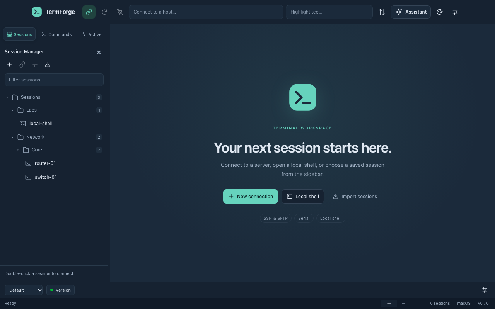
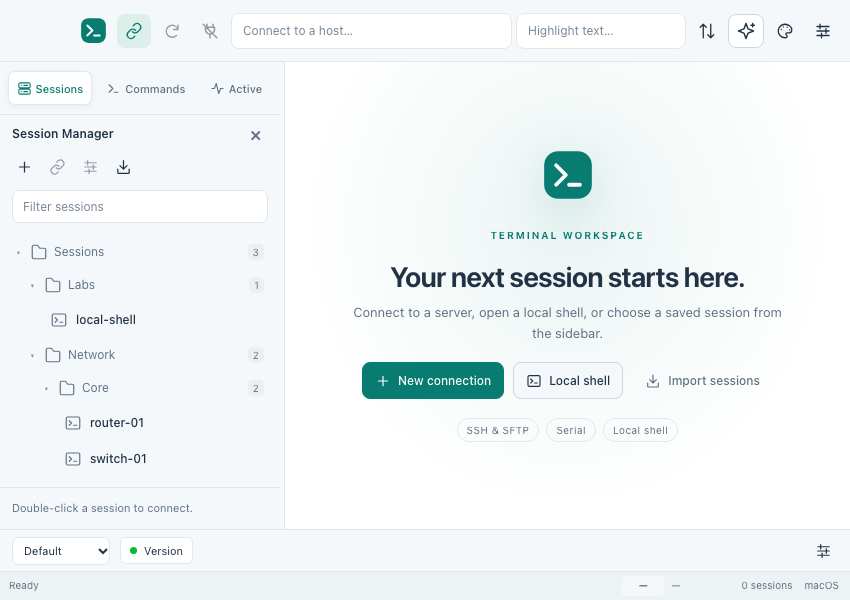
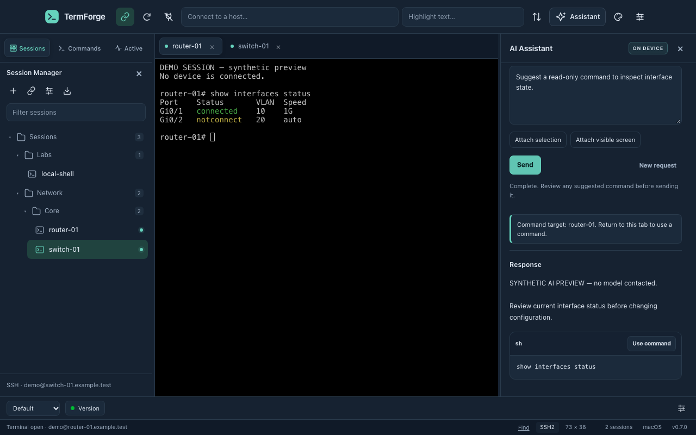

# ForgeCRT interface

ForgeCRT's 0.7 interface uses an original slate and teal design with consistent vector icons, readable controls and a terminal-centered layout. The session-management workflows remain familiar while the visual design follows ForgeCRT's own identity.

These headless previews use synthetic sessions and AI responses. No device or model is connected, and native window controls are not pictured.

## Find your work

The manager switcher runs horizontally across the sidebar:

- **Sessions** shows saved connection profiles and their folders. Search, select a profile and open it in the terminal workspace.
- **Commands** shows saved command buttons.
- **Active** lists open terminal sessions so you can switch between them.

The toolbar keeps connection actions and workspace tools close to the terminal. Buttons retain accessible names and hover descriptions. With no terminal open, the welcome screen offers **New connection**, **Local shell** and **Import sessions**.

Each tab group keeps its selected terminal. Move tabs between groups, resize their split or restore a saved workspace using the existing [tab group and snapshot controls](https://github.com/distractedagain/termforge/blob/main/docs/TAB-GROUPS.md). The Command Window and saved command buttons remain below the terminal workspace.

## Choose the appearance

Use **Options → Global Options** to select a light or dark interface. Open **Options → Color Schemes** or the palette toolbar button to preview a terminal palette, including Solarized Dark and Solarized Light.

Select **Match interface to default scheme** to carry that palette into the toolbars, sidebar, dialogs and AI Assistant. The preview uses the terminal's ANSI renderer. Applying a default scheme retains explicit per-session color overrides. The [color scheme guide](https://github.com/distractedagain/termforge/blob/main/docs/COLOR-SCHEMES.md) describes inheritance and the available presets.

The refreshed dialogs use clearer category navigation, rounded fields and consistent button spacing. Color Scheme cards show their palette beside a larger sample terminal.

## Use the AI Assistant

Open **View → AI Assistant** or its toolbar button. The provider badge identifies on-device or free online mode. Choose a model connection and task, then enter a question.

**Attach selection** and **Attach visible screen** create an editable context card. Review its contents before sending; pattern-based secret masking cannot recognize every secret. Online mode shows its API-key field, provider disclosure and sharing checkbox together. These controls remain part of the request flow.

Replies appear as readable text and separate command cards. **Use command** places a completed suggestion in the Command Window for review. Sending still requires checking the exact command and original target. Neither the refreshed appearance nor the AI panel executes suggestions automatically.

The assistant remains resizable. At compact window widths it overlays the right side of the workspace; its header stays available while the form and response scroll. Close it with the header control or Escape to return to the workspace. See [AI Assistant setup and privacy](https://github.com/distractedagain/termforge/blob/main/docs/AI-ASSISTANT.md) for connection requirements and limits.

## Verification status

The 0.7.0 source passed **156 backend tests and 97 headless interface checks**, with no failures or browser errors. Checks cover desktop and compact layouts, light/dark and matching palettes, keyboard focus, reduced motion, navigation, tab groups, dialogs, AI review behavior and layout persistence after restart. These checks use synthetic application data; no local Electron window was launched. Packaged interactive desktop testing is not claimed.

The [v0.7.0 preview](https://github.com/distractedagain/termforge/releases/tag/v0.7.0) is public. [Native CI](https://github.com/distractedagain/termforge/actions/runs/38335309021), [packaging](https://github.com/distractedagain/termforge/actions/runs/38335319969) and [publication](https://github.com/distractedagain/termforge/actions/runs/38335846155) passed at tagged source `b2515479c65288e173fe6033b468d8233bbee258`; public assets and build records were checked against their checksums, asset digests and source commit. This verifies distribution provenance, not packaged interactive rendering or real device/model behavior.
