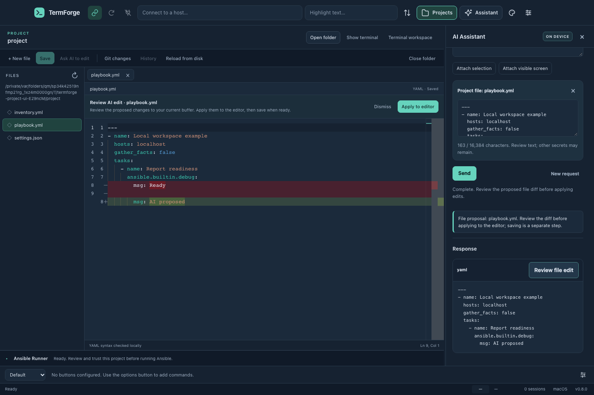

# Project workspace

TermForge 0.8 adds an automation workspace alongside its terminal sessions. Open **Projects** or **File → Open Project**, choose a local folder, and select a text file. Opening or browsing a project does not run its code or connect to its hosts.


Headless browser preview using a temporary localhost example; native window controls are not shown.

## Editing

The locally bundled Monaco editor supports file tabs, search, syntax highlighting, YAML diagnostics and automation snippets, JSON language services, and Python/Jinja text editing. These are built-in editing tools, not a VS Code extension host. Choose **Save** or press Command/Ctrl+S to write a file. Files changed outside TermForge require reloading/reconciling; saving does not silently overwrite the newer disk content. New files must be inside the selected project. Binary files, symlink paths, `.git` contents and files larger than 2 MiB are excluded.

A terminal pane can remain visible beneath the editor. Terminal sessions retain their state when switching workspaces. Unsaved project files are tracked separately from terminal tabs and prompt before being discarded or quitting.

## Changes and backups

Git review displays branch/status and diffs for the selected local repository. It does not stage, commit, push, fetch, run hooks, or execute configured external diff/text conversion tools. It is intended for reviewing work before using your normal Git workflow. Linked Git worktrees/submodules and executable repository configuration are not supported by this first integration.

Saving an existing file creates a private backup outside the repository in TermForge's application data. **History** lets you compare an earlier version then choose **Restore and save** to restore it through the same conflict-checked save path. These are versions of edited project/configuration files, not automatic backups collected from remote devices. Device collection requires a playbook appropriate to that device.

## Ansible runtime

Install Ansible Core and Ansible Runner in a Python virtual environment on your controller. TermForge does not install Python packages or vendor automation collections automatically.

On macOS or Linux, for example:

```sh
python3 -m venv ~/.local/share/termforge-ansible
~/.local/share/termforge-ansible/bin/python -m pip install ansible-core ansible-runner
```

Choose **Local** and enter the absolute path to that environment's Python executable. The runtime check reports whether the required packages are available. Python/Ansible versions must support each other; see the [Ansible installation guide](https://docs.ansible.com/projects/ansible/latest/installation_guide/intro_installation.html).

On Windows use **WSL**, install the runtime inside the default WSL distribution, and specify its Linux Python path. The selected Windows project must be accessible from that distribution. Native Windows Python is not an Ansible controller. Remote SSH controllers and container execution environments are future integrations.

## Review and run

1. Save the playbook and inventory. Start with `examples/automation/hello.yml` and `inventory.yml` in this repository for a harmless localhost example.
2. Choose the controller, playbook, inventory, target limit and execution mode.
3. Confirm you trust the project. Ansible configuration, plugins, inventory and tasks can execute code as your user even during validation. This trust applies to an explicit action, not merely opening the folder.
4. Review the prepared run, then start it. Edits to the reviewed playbook or inventory invalidate the plan; prepare a new one.
5. Follow task/host output and the final status. Cancel to stop the owned job.

**Syntax** validates a playbook through Ansible. **Check + diff** reports predicted changes for modules that support it. A task can override check mode, and unsupported modules may provide no useful preview. **Run** can change the selected systems. Review the target limit before either check or run. Diff output can contain sensitive configuration; respect `no_log` and `diff: false` in playbooks. See [Ansible check/diff documentation](https://docs.ansible.com/projects/ansible/latest/playbook_guide/playbooks_checkmode.html).

Cancellation is not rollback. An already-dispatched remote operation may finish after the controller stops. Results marked cancelled or incomplete must not be interpreted as proof that no changes occurred. Close active jobs before replacing or closing their project.

## AI file proposals

Choose **Ask AI to edit** on the active file, review the attached text, describe the change, then explicitly send the request. The existing local Ollama and free online provider choices remain available. No repository is uploaded automatically. Online requests still require per-request sharing consent; free online quota limits still apply.

Only completed fenced replies can be reviewed as a proposed complete file. TermForge compares the proposal with the captured editor buffer and rejects applying it after the file/project/buffer changes. Review the diff, apply to the editor, then save separately. An AI proposal never starts Ansible or a terminal command. Whole-file application is disabled when automatic context masking altered possible secrets. Large files must be reduced to fit the assistant's existing context limit.



This preview uses a synthetic AI response. No real model or network device was contacted.

## Limits

This is a focused automation editor, not full Visual Studio Code. It does not include an extension marketplace, a debugger, remote file editing, scheduled jobs, Git publication, credential storage for playbooks, or a device-independent rollback engine. Ansible and Python are external runtime requirements; vendor collections must be installed in that environment separately. Tests use temporary files, synthetic AI providers and localhost playbooks; they do not establish compatibility with every device collection or production network.
